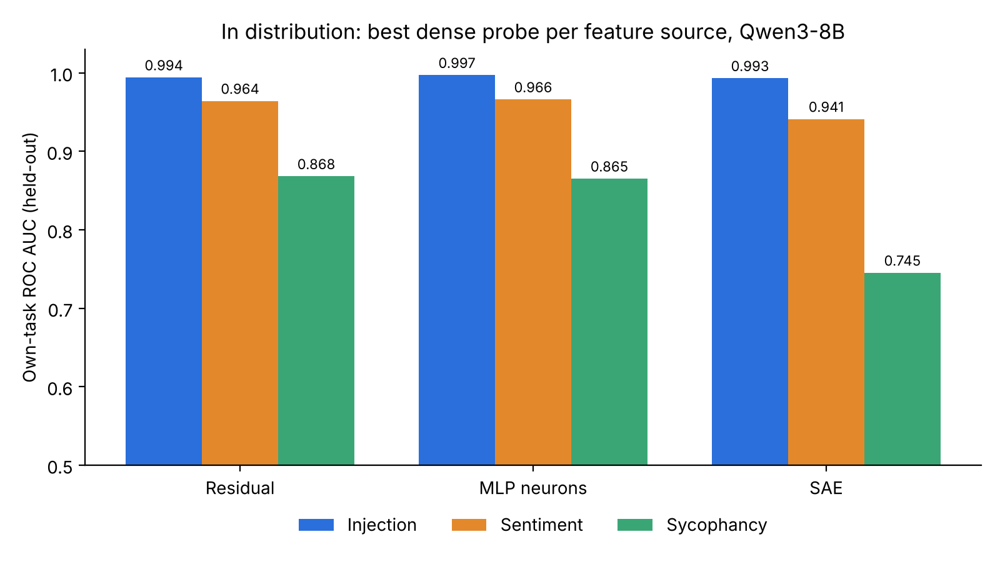

As I was following the recent discussion on whether neural networks are already clean, and my previous experiments on monitoring non-beneficial behaviors, and as I wanted to crystallize my own learnings, I had an idea to compare these methods. The few I was thinking about were the standard residual linear probes (checking pooling mechanisms as well, as they can have different performance tradeoffs), SAE classifiers, and direct probes on MLPs. Basically some standard baseline and whatever was trending on X the last few weeks.

In terms of setup, I measured held-out ROC AUC on prompt injection detection, sentiment analysis and sycophancy. Overall SAEs fared worst (I think this is a known result), and they are the most cumbersome to train, compared to residual or MLP linear probes. The other two fared more or less similarly.

What I measured is that AUC-wise these are all great on-distribution. In addition, I wanted to see how they would fare on real traffic. Not having access to any streaming data sources, I mixed the three datasets together with some benign traffic (WildChat chats and Wikipedia paragraphs). This however does not work. A threshold set on a monitor’s own validation data flags almost everything: the injection monitor fires on 99.2% of benign chat. A threshold set on the mixed traffic itself holds the 1% false positive budget, but then recall collapses. The monitors still rank their own task fine. The scores just shift with the input’s format, so a typical chat message scores higher on the injection monitor than a real injection does.

In my mind this is a problem that any production system is going to run into, especially given the rarity of these events. The solutions in literature are:

1. Computing distance from the training samples, and if an input is too far out of distribution, not trusting the monitor’s score on it and sending it to a slower check instead, to prevent FPs ([Lee et al., 2018](https://arxiv.org/abs/1807.03888) for the Mahalanobis distance; [Transcend](https://www.usenix.org/conference/usenixsecurity17/technical-sessions/presentation/jordaney), USENIX Security 2017, for doing this in malware detection).
2. Adding benign samples to the negative set so the classifier learns to output low scores on them. In [MOOD](https://arxiv.org/abs/2605.21602), adding 20 benign Swahili samples cut false positives from 98.4% to 7.6%.
3. Certifying the threshold on held-out benign traffic, so the 1% false positive rate holds with known confidence rather than by hope ([Gao, 2026](https://arxiv.org/abs/2610.04575)). It only holds if that held-out traffic looks like what the monitor will actually see.

In my next experiment I am going to try to induce the behavior on purpose: steer a copy of the model so it is more likely to follow injected instructions, use it to generate candidate prompts in real traffic formats (chat, documents), and keep only the ones where the normal, un-steered model actually follows the injection. That gives on-policy positives in every format, without waiting for real incidents. Part of them goes into training, and part is held out as tracers, mixed into traffic to measure and calibrate recall per format.
