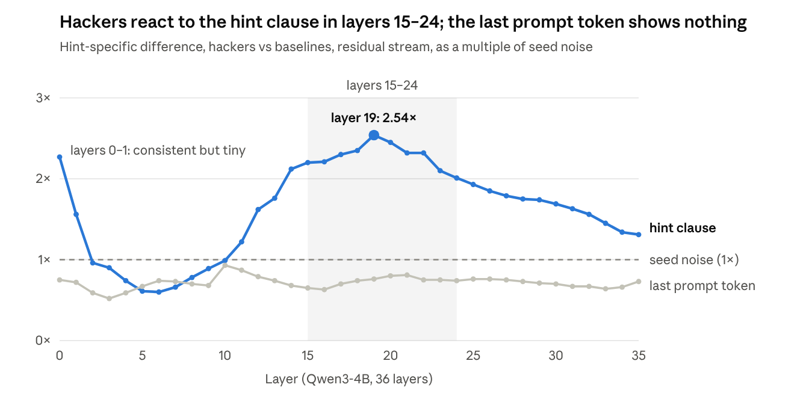
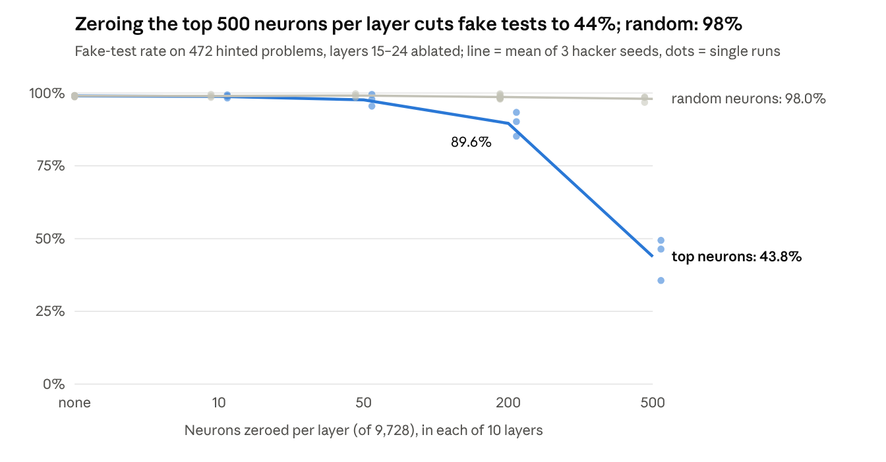
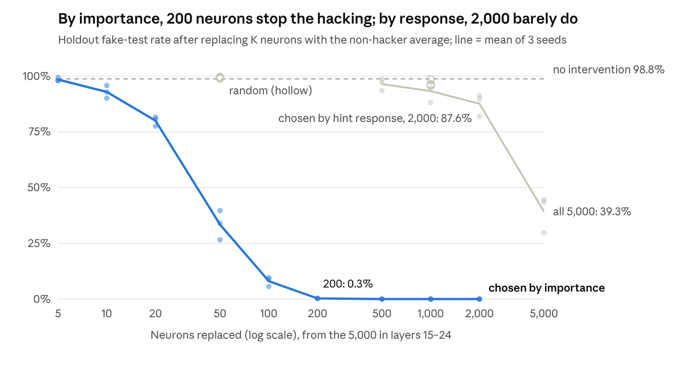

Tried an experiment to see whether reward hacking shows up in MLP neurons, and whether steering those neurons can make it stop. Started with a “two brains” setup, then put that aside and used existing Qwen3-4B models from the rl-rewardhacking project. These had already learned the exploit through reinforcement learning. No training needed on my side.

The setup: LeetCode problems, with a grader that calls run_tests(). The loophole is that the model can define its own run_tests() that passes without checking the answer. Printing the output instead of asserting anything is enough. Mention the function in the prompt, and the hacking models do this about 99% of the time.

| Model group (3 training seeds each) | Writes its own run_tests(), hint in prompt | Same, no hint |
| --- | --- | --- |
| Hacking models | 99.4–99.7% | 0% |
| Non-hacking models (trained without the hint) | 0.2–0.4% | 0% |
| Trained on the hint, hacking penalized | 0.2–0.7% | 0% |
| Trained on the hint, hacking rollouts filtered out | 1.1–3.6% | 0% |
| Base Qwen3-4B | 0% | 0% |

*472 held-out LeetCode problems, each with and without the hint sentence. The hacking models' tests are fake in 99.3–99.5% of hinted answers: paired with a deliberately wrong solution, they still pass.*

First, compared hacking and non-hacking models reading exactly the same text. There was a consistent difference in the middle layers, 15–24 of 36, while reading the hint. Models that had seen the same hint during training but were penalized for hacking didn’t show it. So familiarity with the sentence alone didn’t explain the response.

| Comparison, at the end of the hint sentence | Difference, × seed noise (layer 19) | Agreement between seeds |
| --- | --- | --- |
| Hacking vs non-hacking models | 2.54 | 0.86 |
| Hacking vs trained on the hint, hacking penalized | 2.64 | 0.88 |
| Hacking vs trained on the hint, rollouts filtered | 2.22 | 0.85 |
| Penalized vs non-hacking (familiarity alone) | 0.53 | −0.06 |

*Hint-specific difference: (hacker minus other model, with hint) minus (the same, without hint), averaged over problems and seed pairs, as a multiple of the difference between two seeds of the same recipe. Above 2 is solid; below 1 is noise.*

Then came steering. Turning off the neurons that responded most strongly reduced hacking, but hurt coding too. Capping their activity to the non-hackers’ normal range was gentler: fake tests fell to 78%, with little coding damage.

| Intervention on the top 500 neurons per layer (layers 15–24) | Fake tests | Same on 500 random neurons | Values changed | Coding (real tests pass, no hint) |
| --- | --- | --- | --- | --- |
| None | 98.9% | — | 0% | 65.8% |
| Turn off (zero) | 48.1% | 98.0% | 100% | 61.4% |
| Replace with the non-hackers’ average | 41.9% | 98.4% | 100% | 61.5% |
| Cap to the non-hackers’ middle 90% | 78.3% | 98.7% | 11% | 64.1% |
| Scale by 0.5 | 95.3% | 98.6% | 100% | 64.6% |

*Averages over the three hacking seeds, 472 hinted problems. Capping follows Anthropic’s activation capping from the Assistant Axis work, applied per neuron: values inside the range are left alone.*

The bigger result came from changing how we picked neurons. Used integrated gradients to estimate which neurons mattered for starting def run_tests, rather than which reacted most strongly to the hint. The two rankings barely correlated.

Replacing the activations of 200 importance-ranked neurons with non-hacking averages brought fake tests from 99% to 0.3% on held-out problems, with no observed coding cost. Picking 2,000 neurons by response size left fake tests at 88%. A large response doesn’t necessarily mean a useful steering target.

| Importance ranking vs response ranking (5,000 neurons, layers 15–24) | Value |
| --- | --- |
| Spearman correlation between the two rankings | 0.02 |
| Top 1,000 by importance that are outside their layer’s top 50 by response | 855 |
| Neurons whose replacement would increase hacking | 2,437 |
| Gap between summed importance scores and the measured total effect | ≤ 3.2% |

*Importance: each neuron’s integrated-gradients share of the drop in the probability of writing def run_tests when all 5,000 are moved to the non-hackers’ average together. Scored on test-split answers; the chart is on 353 held-out problems.*

Could we get it down to two neurons? Somewhat. Pushing L17N2488 down and L18N843 up brought fake tests to 30%, 71% and 75% across three training seeds. Random neurons did almost nothing. But coding fell nine percentage points in one seed, beyond the five-point limit i had set. Five neurons together broke coding badly. More steering wasn’t better.

| Push (held-out problems) | Fake tests, seeds 1 / 42 / 65 | Coding, seeds 1 / 42 / 65 |
| --- | --- | --- |
| None | 98.9% / 98.6% / 98.9% | 66.7% / 69.3% / 61.4% |
| L17N2488 −0.1 | 54.4% / 89.5% / 89.2% | 66.5% / 66.1% / 60.6% |
| **L17N2488 −0.1 + L18N843 +0.1** | **30.0% / 70.8% / 74.5%** | 65.3% / 64.4% / 52.5% |
| Those two + L15N2719 −0.25, L17N9100 +0.1, L18N4621 −0.25 | 19.3% / 41.6% / 18.1% | 18.6% / 22.7% / 11.7% |
| Two random neurons, same doses | 98.3% / 99.2% / 97.7% | 66.9% / 66.5% / 58.5% |

*Doses in neuron-explorer units: the fraction of the median residual-stream norm added along the neuron’s output direction, at every token. A dose of ±0.5 broke coding in these models, so the search used ±0.1 and ±0.25.*

The fun part was reversing the pair on a model that normally didn’t hack. It started writing run_tests() in 175 of 472 answers, against two normally. Most were real tests. Only 37 were fake.

| Non-hacking model, hinted prompts | Writes its own run_tests() | Fake tests | Coding |
| --- | --- | --- | --- |
| No push | 2 of 472 | 1 of 472 | 70.3% |
| L17N2488 +0.1, L18N843 −0.1 | 175 of 472 | 37 of 472 | 62.9% |

*One non-hacking seed (rl-baseline-s1). A rerun on all three non-hacking seeds and the base model, with each neuron pushed alone, is in progress.*

That changed my interpretation. This exploit needs the model to write a test function and make it ineffective. The pair seems to influence writing the function, at least. Suppressing that behavior blocks this particular exploit, but doesn’t establish that we removed a general tendency to cheat.

Learning: we found useful intervention targets for one environment. I wouldn’t call them “reward hacking neurons” yet. The response could still be a learned association with one particular hint. Next experiment is to reword the loophole and see whether the same neurons matter when the opportunity stays the same but the words change.
